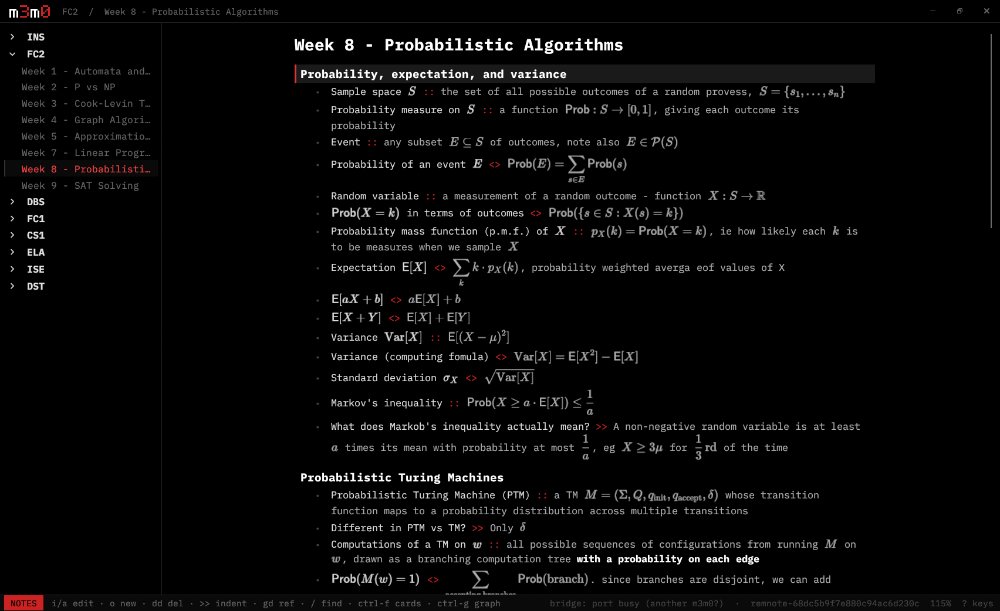
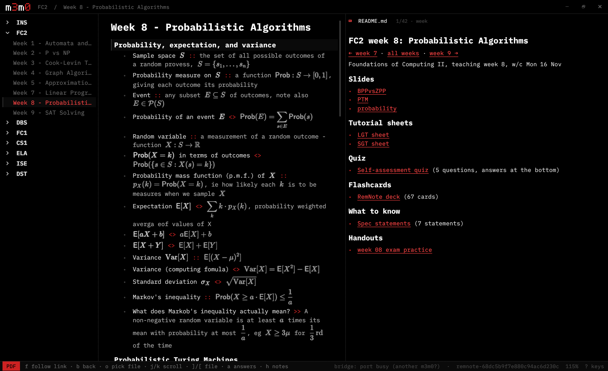
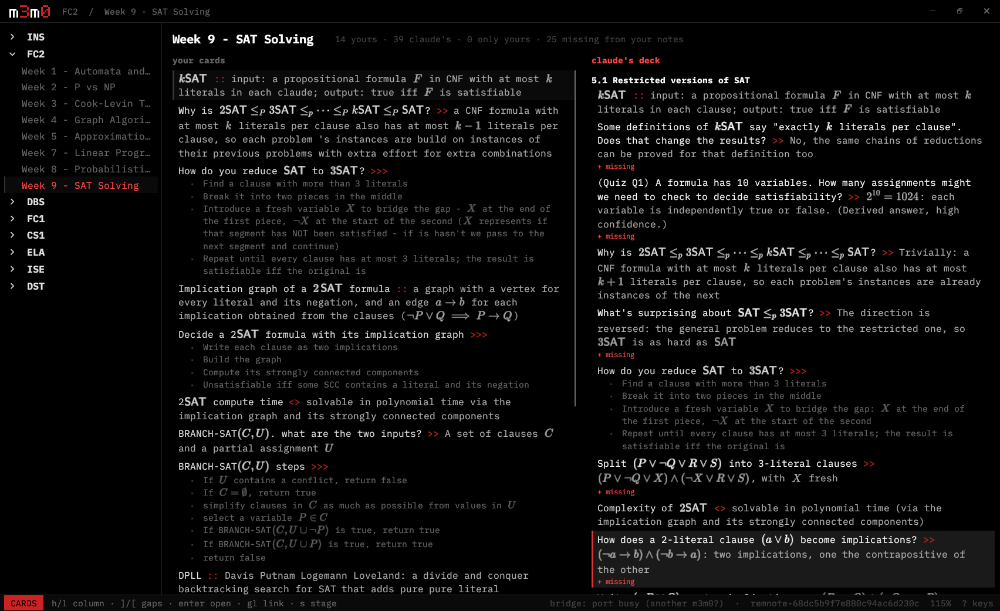
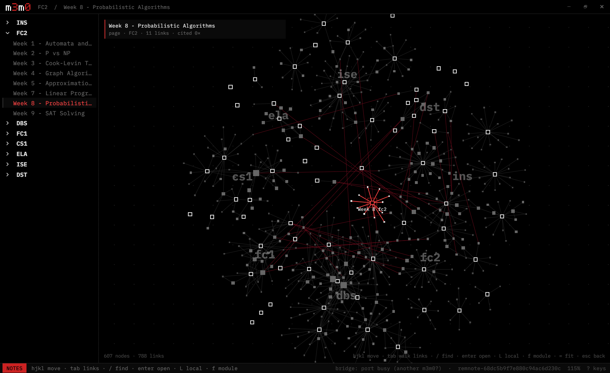

# m3m0

a native remnote client. remnote's desktop app is electron and it lags, so this is the ui rewritten in rust + egui: all black, blexmono, red accents, keyboard-first.

remnote itself keeps running as the sync engine (its cloud sync only exists inside its app). m3m0 reads its local db and writes back through a small remnote plugin, so remnote still owns sync.



## what's in it

- **outliner editor**: vim-style, whole app drivable from the home row. insert mode, `o`/`dd`/`>>`, undo, `[[` autocomplete, inline katex. the rich text round-trips losslessly (`m3m0 roundtrip` reports 0 differ over all 3700 of my rems)
- **graph view**: pages, terms and citations, module islands, walk links with `tab`
- **week files pane**: every file for the open week next to the notes. readme with followable links (`f` hints, `b` back), quiz json (answers on `a`), markdown, pdfs, images, text
- **claude flashcards**: claude's decks shown next to my own cards, gaps highlighted, `gl` to link a rem to one of claude's cards
- **claude chat**: `claude -p` with the whole module as context. it can only edit claude's own files under `<module>/revision/`, never my rems
- **flashcard review**: remnote's own scheduler, graded through the plugin

| files pane | cards + gaps |
|---|---|
|  |  |



## build and run

```
cargo build --release
./target/release/m3m0 --install   # icon + .desktop entry, so it shows in the app grid
./target/release/m3m0
```

the plugin (once, and after changing it):

```
cd plugin && npm install && npm run build
```

m3m0 serves `plugin/dist` on `localhost:47831`. in remnote: settings > plugins > build > develop from localhost. see `docs/bridge.md`.

`?` in the app lists every key (tabbed, opens on the current pane's section). `:db` picks which database to read.

## data safety

- reads only ever go through a snapshot of remnote's sqlite db (the backup api), so it's safe while remnote runs
- the db is never written. every write goes through the plugin, staged first (`:w` shows the diff, `:log` reverts)
- bridge tests create a scratch tree and delete it after; they never touch real notes

## dev

env vars: `M3M0_DB` (db path), `M3M0_OPEN="FC2/Week 8"` (open a week), `M3M0_KEYS` (replay keys), `M3M0_SHOTS=DIR` (save frames and quit). `scripts/preview.sh` renders frames on a secondary monitor. docs: `docs/design.md` (every decision and why), `docs/plan.md` (status).
